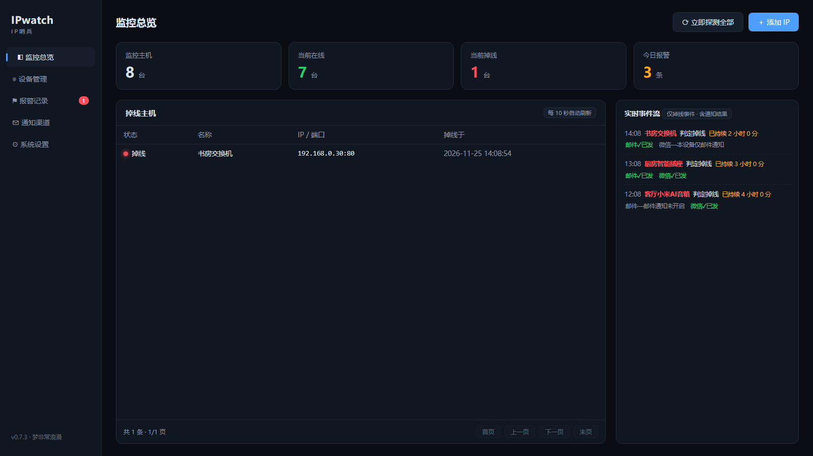
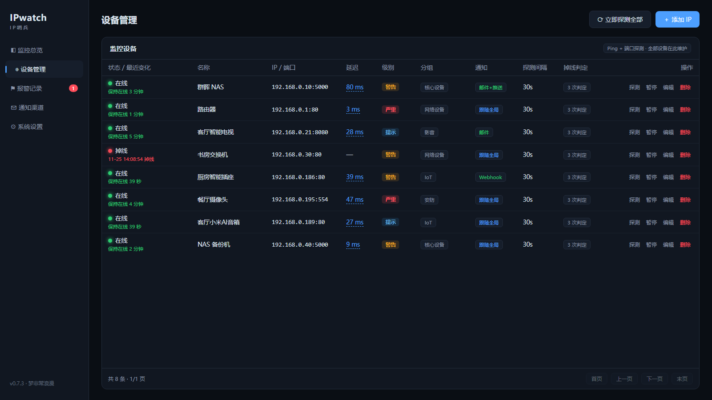
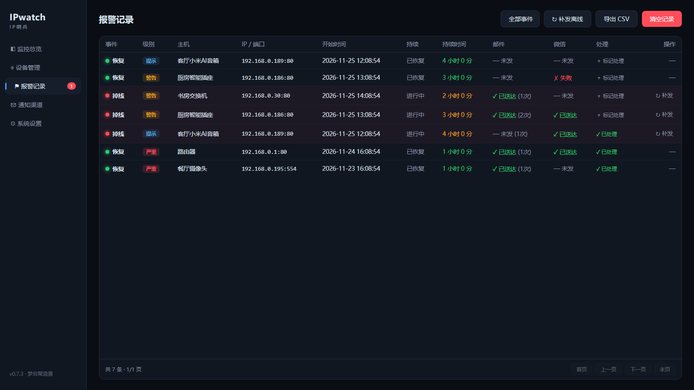
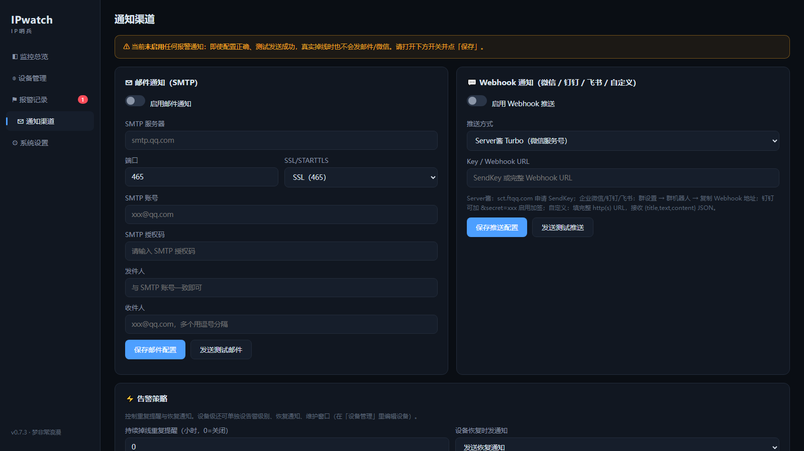

# IPwatch · IP 哨兵

> 轻量级主机在线监测工具，专为飞牛 fnOS 打造。添加 IP 后周期探测，掉线自动发邮件或微信提醒，应用内实时查看报警记录。


---

## 简介

IPwatch 是一个运行在飞牛 fnOS 上的第三方应用，对标 Zabbix 的最小可用子集。它以极低的资源占用，持续监测 NAS 所在网络中的设备（路由器、服务器、摄像头、其他 NAS 等）是否在线，一旦掉线立即通过邮件或微信渠道推送告警，并在应用内留下完整的报警记录供追溯和处理。

界面采用深色「监控驾驶舱」风格，首页一屏展示在线统计、掉线主机和实时事件流。数据存储使用 Node.js 22 内置的 SQLite，无需额外数据库服务。

---

## 功能特性

### 监测能力
- **周期探测**：按设备或全局间隔周期检查，连续失败 N 次才判定掉线，避免网络抖动误报
- **Ping → 端口 → ARP 三级探测**：先 Ping；配了端口则连 TCP（收到 RST 也算在线）；都不通时对同网段设备用 ARP 查网卡 MAC。**端口可留空**，只有 IP 也能检测在线
- **设备分组**：按分组归类管理，支持自定义每台设备的探测间隔、重试次数和告警级别
- **延迟与丢包曲线**：每次探测记录延迟，点击设备的延迟数值可查看 6 小时至 7 天的趋势图与丢包统计

### 告警通知
- **多渠道推送**：邮件（SMTP）、Server 酱、企业微信、钉钉（含加签）、飞书、自定义 Webhook
- **每台设备独立配置通知**：可为单台设备指定渠道，或跟随全局默认
- **掉线 / 恢复通知**：恢复通知可全局开关，也可每台设备单独覆盖
- **重复提醒**：持续掉线可每 N 小时自动重发，直到设备恢复或进入维护窗口
- **维护窗口**：设备级时段内静默告警（仍照常监控），支持跨天时段，适合计划内停机

### 报警记录
- **完整留痕**：掉线 / 恢复全程记录，含发生时间、持续时长、告警级别、通知送达结果
- **确认与备注**：可对报警标记「已处理」并填写处理备注
- **一键补发**：对历史掉线记录用当前配置重新发送通知；测试邮件成功后可自动补发仍掉线的设备
- **CSV 导出**：报警记录支持导出留存

### 安全与运维
- **访问密码与多用户**：首次打开强制设置访问密码，支持添加多个登录账户
- **邮箱打码显示**：敏感信息脱敏展示
- **备份 / 还原**：系统设置内一键导出 / 导入配置与数据
- **数据自动清理**：按保留天数自动清理过期报警记录

---

## 界面预览

**监控总览** — 在线 / 掉线统计、掉线主机列表、实时事件流



**设备管理** — 增删改查、分组、告警级别、通知方式、维护窗口



**报警记录** — 级别、持续时间、通知结果、处理备注、补发



**通知渠道** — 邮件 / Webhook 配置、告警策略、恢复通知



---

## 安装

### 环境要求
- 飞牛 fnOS
- Node.js v22 运行时应用（`nodejs_v22`，安装时会自动提示依赖）

### 方式一：应用中心本地安装
1. 从 [Releases](../../releases) 下载最新版 `ipwatch_v*.fpk`
2. 将 FPK 文件上传到 NAS
3. 在 SSH 中执行：
   ```bash
   appcenter-cli install-local /path/to/ipwatch_v0.8.7.fpk
   ```
4. 安装完成后，在飞牛桌面打开 IPwatch

### 方式二：源码打包
```bash
# 在项目目录执行（需 fnpack 工具）
fnpack build --directory ipwatch
```
打包后生成的 `ipwatch.fpk` 会按 manifest 版本号重命名（如 `ipwatch_v0.8.7.fpk`），不会覆盖历史版本。

---

## 快速上手

1. **设置访问密码**：首次打开应用会要求设置访问密码（至少 4 位）
2. **配置通知**：进入「通知渠道」填写 SMTP 或 Webhook 信息，点击测试确认可送达
3. **添加设备**：进入「设备管理」添加要监控的 IP / 域名；端口可留空（仅用 Ping / ARP 检测），也可填 TCP 端口多一层兜底
4. **查看状态**：回到「监控总览」查看在线 / 掉线统计和实时事件流
5. **处理报警**：掉线后到「报警记录」查看、备注、补发

> 提示：「测试发送成功」不等于「报警已启用」。请确保目标设备的通知方式不是「不通知」，且全局通知开关已打开。

---

## 技术说明

| 项目 | 说明 |
|------|------|
| 运行时 | Node.js 22（使用内置 `node:sqlite`，零原生编译依赖） |
| 数据库 | SQLite（WAL 模式），数据存放在应用数据目录 |
| 后端依赖 | 仅 `nodemailer`，其余（HTTP、SQLite、Webhook）均使用 Node 内置模块 |
| 前端 | 原生 HTML / CSS / JavaScript，无前端构建步骤 |
| 探测方式 | ICMP Ping → TCP（RST 判活）→ 同网段 ARP（端口可留空） |
| 服务端口 | 5210（端口模式，通过飞牛网关前缀 `/app/ipwatch` 访问） |
| 图标生成 | `scripts/gen-icons.js`（开发期工具，需 Python + Pillow） |

### 项目结构

```
ipwatch/
├── manifest                 # 飞牛应用清单
├── cmd/                     # 生命周期脚本（install/upgrade/uninstall/config/main）
├── config/                  # 权限与资源声明
├── app/
│   ├── ui/                  # 桌面入口配置与图标
│   └── server/
│       ├── server.js        # HTTP 服务与 API 路由
│       ├── lib/
│       │   ├── db.js        # SQLite 数据层与表结构迁移
│       │   ├── monitor.js   # 探测调度
│       │   └── notify.js    # 邮件与 Webhook 通知
│       ├── public/          # 前端页面与介绍页截图
│       └── package.json
├── scripts/                 # 图标生成工具与源图
├── LICENSE
└── build.sh                 # 打包脚本
```

---

## 版本

当前版本：**v0.8.7**

完整更新记录见 [manifest](manifest) 中的 `changelog` 字段。

---

## 作者

**梦非常浪漫**

---

## 许可证

见 [LICENSE](LICENSE)。
